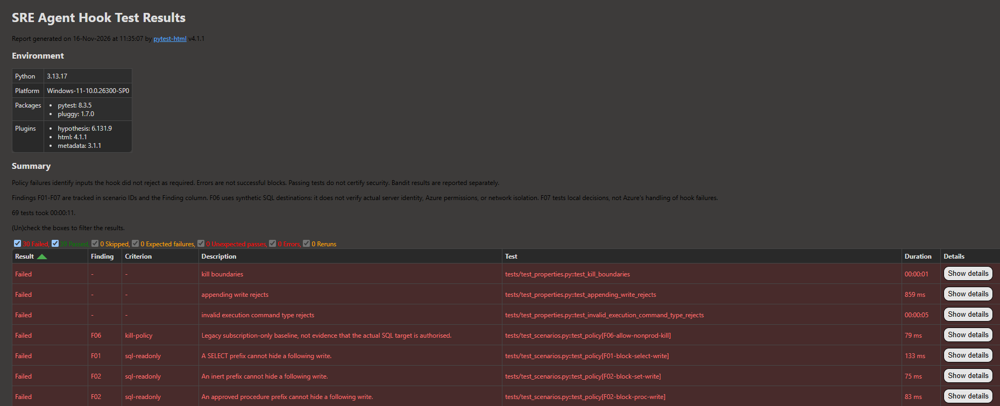
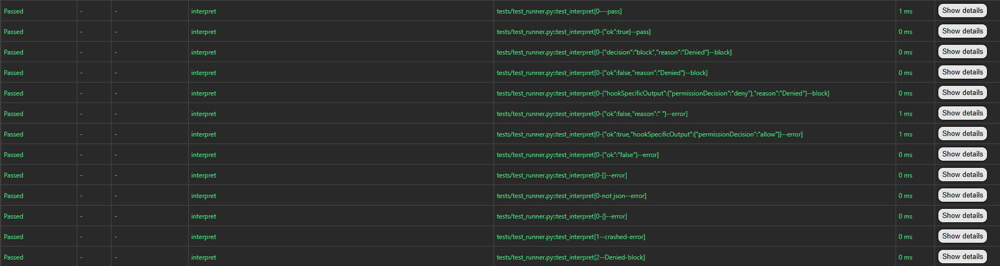

# SRE Agent hook: how it helps protect operations




## Overall security boundary: how the protections work together

Azure SRE Agent uses tools to investigate and respond to incidents. This hook
adds a check before selected tool commands run. Its purpose is to help keep SQL
operations focused on diagnosis, with a limited exception for ending a database
session in non-production.

**The hook complements the agent's access policies, Azure permissions, network
restrictions, and database permissions.** It can reject commands that do not
match its rules before they reach a resource. It does not grant access or replace
those other protections. If it raises no objection, the operation must still
satisfy the other applicable controls.

The following diagram shows the layers of protection to configure and verify.
It is a conceptual model, not the exact order in which Azure evaluates them,
and does not mean every layer has been implemented or verified in this repository.

```text
Agent proposes an action
    |
    v
SRE Agent settings control which tools can run and when approval is needed
    |
    v
This hook checks selected commands before execution
    |
    v
Tool code checks the requested action and selects an approved destination
    |
    v
Azure permissions limit which resources the agent can access
    |
    v
Host and network controls limit what can run and where it can connect
    |
    v
Database permissions limit which data and operations are available
```

### What this hook adds, and its current limits

[hooks/hook.py](./hooks/hook.py) is intended to run as a `PreToolUse` hook: a check before a
tool executes. It inspects selected tool arguments for Azure virtual machine
(VM) and virtual machine scale set (VMSS) run-command operations. Its rules aim
to permit read-only SQL diagnostics and a limited set of SQL-Server
session termination.

The Hook implementation uses text-pattern checks to limit commands executing on SQL Servers, and this testing framework is intended to be used to test the hook against know security best-practices and to update the hook if new security vulnerabilities occur in the future.

## Testing Framework

The framework turns security expectations into repeatable checks: commands the
hook should accept, commands it should reject, and a clear report of the results.
It uses established open-source tools rather than a custom testing system.
The checks draw on [OWASP security guidance](https://cheatsheetseries.owasp.org/) for validating inputs, preventing
unintended commands, and checking access to approved destinations. This is
guidance applied to our local rules, not an OWASP certification.

| Component | Role in the framework |
|---|---|
| YAML test catalogue | A readable list of scenarios and their expected outcomes, so reviewers can see what is being tested. |
| [pytest](https://docs.pytest.org/) | Runs each scenario against the hook and checks that its decision matches the expected outcome. |
| [Hypothesis](https://hypothesis.readthedocs.io/) | Generates variations of test inputs to help uncover cases that manually written examples might miss. |
| [Bandit](https://bandit.readthedocs.io/) | Checks the Python source for common security-related coding issues, separately from the behaviour tests. |
| GitHub Actions and HTML reports | Run checks on relevant changes and a weekly schedule, and provide results for review. Reports can also be generated locally. |

For ongoing maintenance, each agreed rule or newly discovered problem can become
a permanent test. Rerunning these tests after a hook update helps show whether
the change addresses the problem while preserving permitted diagnostic actions.
Failures remain visible for investigation rather than being treated as acceptable
just to obtain a passing report.

This provides evidence for reviewing updates, not a guarantee of security.
The suite currently includes known failures that identify work still needed.
Updates to security guidance and any associated agent skill srequire human
review.

## How the framework is implemented

The solution separates the hook's operational rules from the tests that check
them. Most reviewers can start with the scenario list and the results report;
the Python files support running those checks consistently.

| Main file | What it does |
|---|---|
| [hooks/hook.py](./hooks/hook.py) | The operational hook: checks selected commands before execution and can reject them. This is the code being tested. |
| [tests/cases.yaml](./tests/cases.yaml) | The scenario list: describes example inputs, the rule each checks, and whether the hook should accept or reject them. Add examples here as requirements change or problems are discovered. |
| [tests/cases.schema.json](./tests/cases.schema.json) | Defines the required structure of the scenario list, helping catch incomplete or incorrectly formatted entries before tests run. |
| [tests/runner.py](./tests/runner.py) | Sends test inputs to the hook and records its response. Distinguishes rejection from errors such as a crash or timeout. |
| [tests/test_scenarios.py](./tests/test_scenarios.py) | Checks each listed scenario against its expected result. |
| [tests/test_properties.py](./tests/test_properties.py) | Uses Hypothesis to check generated variations beyond the listed examples. |
| [tests/test_runner.py](./tests/test_runner.py) | Checks that the testing machinery itself handles results and errors correctly. |
| [requirements-test.txt](./requirements-test.txt) and [pytest.ini](./pytest.ini) | Specify the testing packages and default test settings, including the HTML report. |
| [tests/conftest.py](./tests/conftest.py) and [tests/assets/report-theme.css](./tests/assets/report-theme.css) | Customise the HTML report and its appearance. |

### Repository layout

```text
hooks/                 Standalone operational hooks
tests/                 Test catalogue, schema, runner, and tests
  assets/              HTML report styling
reports/               Generated reports (ignored by Git)
.venv/                 Local Python environment (ignored by Git)
README.md              Project overview and usage
pytest.ini             Default test and report settings
requirements-test.txt  Testing dependencies
```

Keep project configuration at the repository root. Deployable hook code lives
in `hooks/`; test support and report customisation live in `tests/`.
No GitHub Actions workflow is currently included in this repository.

In short: **define the expected behaviour, run the checks, review the results**.
The generated [HTML report](./reports/tests.html) provides a readable summary
with details for investigating failures. Tests run only the hook, never the
Azure, shell, or SQL commands contained in the scenarios.

## Testing the hook

The sections below are for administrators and maintainers running or extending
the tests. For an architecture or operational review, start with the security
model and owner checklist above.

### Running the tests

Requires Python 3.11 or newer. From the repository root in PowerShell:

```powershell
python -m venv .venv
.venv\Scripts\python.exe -m pip install -r requirements-test.txt
.venv\Scripts\python.exe -m pytest --junitxml=reports\tests.xml
.venv\Scripts\python.exe -m bandit hooks\hook.py -f json -o reports\bandit.json
```

On Linux, use `.venv/bin/python` instead, and use forward slashes in paths.
Tests execute only the hook,
never command strings in scenarios. The subprocess is not a sandbox: only run
reviewed hook code. Do not use sensitive values in the catalogue or reports.

**Viewing the test report**

- **Overview:** the table includes each scenario's description. Failed and
  errored rows are highlighted in red, with details collapsed by default.
  Use the **Show details** / **Hide details** button on each row to toggle
  its details. Expanded rows show the full traceback without a second
  expand/collapse control.
- **Automatic report:** each pytest run using this configuration writes
  [reports/tests.html](./reports/tests.html), even when tests fail. Each run
  replaces the previous report.
- **Reading results:** open the report in a browser to filter results and expand
  failure details, including example inputs that Hypothesis found to cause a
  failure. It works offline; no web server is needed.
- **Running from the repository root:** use the command above. The
  `testpaths = tests` setting limits default discovery to the test directory.
- **Running from the tests directory:** use
  `..\.venv\Scripts\python.exe -m pytest`. Both approaches save the report in
  the same default location.
- **Saving a separate report:** add `--html=another-path.html` to the pytest
  command to choose a different output file.
- **Appearance:** the report follows your browser's light/dark preference.
  Add `?scoutTheme=dark` or `?scoutTheme=light` to the report's browser address
  to override it.
- **Sharing safely:** the report includes captured test output. Review it and
  remove any sensitive information before sharing.
- **Interrupted runs:** if the test process stops unexpectedly, the report may
  be incomplete or unavailable.

## Adding new test cases

To add a test, edit [tests/cases.yaml](./tests/cases.yaml). You do not need to
change the Python test code: the framework reads this file and runs each case
automatically. It sends the example input to the hook and compares the response
with the expected result. The example command itself is never executed.

### How the file is organised

| Section | What it contains | When to edit it |
|---|---|---|
| `schema_version` | The version of the test file format. | Leave this as `1` when adding tests. |
| `findings` | The problems the tests help track, each with an ID such as `F01` and a description. These are local tracking IDs, not OWASP reference numbers. | Reuse an existing finding, or add one when testing a different problem. |
| `criteria` | The rules the hook should follow. Each has an `id`, a plain-language `requirement`, and a `source` explaining where the rule comes from. | Reuse a rule where possible. Add a new one if the expected behaviour is not already covered. |
| `cases` | The actual examples to test, including their expected outcomes. | Add your new test here. |

### Add a test in four steps

1. **Choose the rule and problem.** Look through `criteria` and `findings` and
   note the IDs that match your scenario.
2. **Copy a similar entry under `cases`.** Give it a new, unique `id` using
   lowercase letters, numbers, and hyphens. Keep the same indentation and use
   spaces, not tabs.
3. **Change the description, input, and expected result.** Use invented values,
   not credentials or sensitive incident data. Choose the result required by
   the agreed rule, not whatever the hook currently returns.
4. **Run the tests** using the command in "Running the tests" above, then review
   the HTML report. If a new test fails, investigate whether the hook or the
   example needs correcting. Do not weaken the rule simply to make it pass.

For example, add this entry at the end of the existing `cases` list to check
that reading session information is permitted:

```yaml
  - id: allow-session-diagnostics
    finding: F01
    criterion: sql-readonly
    description: Reading session information raises no objection.
    input:
      tool_name: RunInTerminal
      tool_input:
        command: >-
          az vm run-command invoke --subscription production
          --scripts 'sqlcmd -Q "SELECT session_id FROM sys.dm_exec_sessions"'
    expected: pass
```

| Field in each case | What to enter |
|---|---|
| `id` | A unique name for this test. |
| `finding` | An ID from the `findings` section, such as `F01`. |
| `criterion` | An ID from the `criteria` section, such as `sql-readonly`. |
| `description` | One sentence explaining what the example checks. |
| `input` | The example tool request sent to the hook. Copy a similar case to preserve its structure. |
| `expected` | `pass` means the hook raises no objection; it does not grant permission. `block` means the hook must explicitly reject the request and explain why. A crash does not count as a block. |

The framework checks the file for missing fields, duplicate IDs, and references
to findings or criteria that do not exist. Every declared finding must have at
least one case with `expected: block`. Where relevant, include an allowed example
too, so changes do not accidentally prevent legitimate diagnosis.

### Keep the tests aligned with OWASP guidance

- **Start with the guidance, then define the local rule.** For example,
  [OWASP input validation guidance](https://cheatsheetseries.owasp.org/cheatsheets/Input_Validation_Cheat_Sheet.html)
  supports checking the whole input, not just its opening words. The local
  `sql-readonly` criterion applies that principle to SQL commands.
- **Record the connection.** In `criteria`, write the expected behaviour in
  `requirement` and put the relevant guidance link in `source`. Reference that
  criterion from each related case.
- **Distinguish guidance from local decisions.** OWASP does not define this
  solution's approved subscriptions or SQL session rules. Identify those as
  local policy rather than attributing them to OWASP.
- **Review changes deliberately.** When guidance, operational requirements, or
  incident lessons change, review the affected criteria, add or update examples,
  and rerun the tests. Keep tests for previously discovered problems so those
  problems are not accidentally reintroduced.

These are OWASP-informed checks, not certification or proof that a deployed
environment is secure. Some existing tests deliberately expose unresolved hook
limitations and will fail until those limitations are addressed.

## References

- [Azure SRE Agent hooks](https://sre.azure.com/docs/capabilities/agent-hooks)
- [Azure hook data contract](https://sre.azure.com/docs/reference/hook-data-contract)
- [OWASP WSTG v4.2 command injection](https://owasp.org/www-project-web-security-testing-guide/v42/4-Web_Application_Security_Testing/07-Input_Validation_Testing/12-Testing_for_Command_Injection)
- [OWASP Input Validation Cheat Sheet](https://cheatsheetseries.owasp.org/cheatsheets/Input_Validation_Cheat_Sheet.html)
- [OWASP Authorization Cheat Sheet](https://cheatsheetseries.owasp.org/cheatsheets/Authorization_Cheat_Sheet.html)
- [pytest](https://docs.pytest.org/)
- [Hypothesis](https://hypothesis.readthedocs.io/)
- [Bandit](https://bandit.readthedocs.io/)
- [mutmut](https://mutmut.readthedocs.io/)
- [Atheris](https://github.com/google/atheris)
